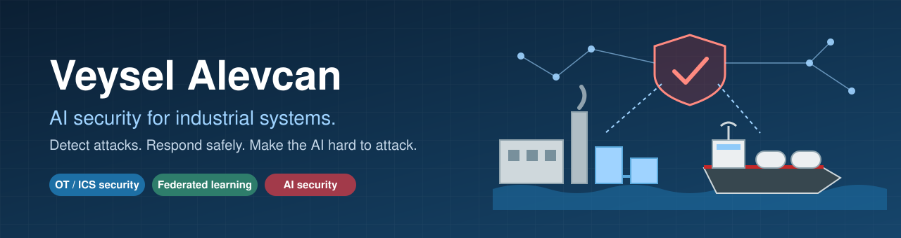
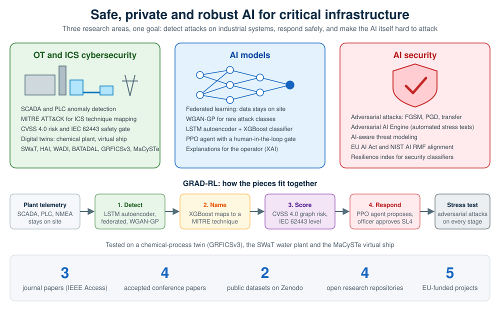

  

  <a href="https://pt.linkedin.com/in/veyselalevcan"><b>LinkedIn</b></a> &nbsp; / &nbsp;
  <a href="#publications"><b>Publications</b></a> &nbsp; / &nbsp;
  <a href="#open-datasets"><b>Datasets</b></a> &nbsp; / &nbsp;
  <a href="#start-here"><b>Code</b></a>

 

I'm **Veysel Alevcan**, an AI and cybersecurity researcher in Lisbon. I'm a PhD researcher at COPELABS, Lusófona University, and a researcher at PDMFC SA.

I build AI that protects industrial control systems (OT): it spots an attack, names the technique, scores the risk and proposes a response, while the plant's data stays on site. I also test how that AI itself can be attacked. The code, trained models and datasets are open.

## Start here

<table>
  <tr>
    <td width="50%" valign="top">
      01 / AUTONOMOUS DEFENSE
      <h3><a href="https://github.com/veyselalevcan/GRAD-RL-Autonomous-Cyber-Physical-Defense-for-ICS">GRAD-RL</a></h3>
      
Detect, name, score and respond. A live defense pipeline for industrial control systems, with a human approval gate for high-risk actions.

      
<a href="https://github.com/veyselalevcan/GRAD-RL-Autonomous-Cyber-Physical-Defense-for-ICS"><b>Open the pipeline →</b></a>

    </td>
    <td width="50%" valign="top">
      02 / MARITIME
      <h3><a href="https://github.com/veyselalevcan/GRAD-RL--Maritime-Digital-Twin-testbed-MaCySTe">GRAD-RL on a virtual ship</a></h3>
      
The same defense tested on a virtual FSRU vessel, against spoofed headings and flooded radar and message traffic.

      
<a href="https://github.com/veyselalevcan/GRAD-RL--Maritime-Digital-Twin-testbed-MaCySTe"><b>Board the testbed →</b></a>

    </td>
  </tr>
  <tr>
    <td width="50%" valign="top">
      03 / FEDERATED LEARNING
      <h3><a href="https://github.com/veyselalevcan/OT-ICS-Cybersecurity-Federated-Learning-and-GenerativeAI">Federated WGAN-GP</a></h3>
      
Anomaly detection across industrial sites without sharing raw data. Code and models behind my IEEE Access paper.

      
<a href="https://github.com/veyselalevcan/OT-ICS-Cybersecurity-Federated-Learning-and-GenerativeAI"><b>Explore the notebooks →</b></a>

    </td>
    <td width="50%" valign="top">
      04 / AI SECURITY
      <h3><a href="https://github.com/veyselalevcan/Adversarial_Machine_Learning">Adversarial AI Engine</a></h3>
      
Automated stress tests for security classifiers: transfer attacks on malware detectors, with metrics for resilience.

      
<a href="https://github.com/veyselalevcan/Adversarial_Machine_Learning"><b>Run the attacks →</b></a>

    </td>
  </tr>
</table>

## Research at a glance

  

## Publications

| Paper | Venue | Links |
|-------|-------|-------|
| A Decentralized Federated WGAN-GP Framework for Anomaly Detection in Industrial Control Systems | IEEE Access, 2026 (published) | [IEEE Xplore](https://ieeexplore.ieee.org/abstract/document/11569888/) · [DOI](https://doi.org/10.1109/ACCESS.2026.3704897) · [Code](https://github.com/veyselalevcan/OT-ICS-Cybersecurity-Federated-Learning-and-GenerativeAI) |
| GRAD-RL: Autonomous Cyber-Physical Defense for Industrial Control Systems via Graph-Augmented Hybrid AI and MITRE ATT&CK-Aligned Threat Classification | IEEE Access (under review) | [Code](https://github.com/veyselalevcan/GRAD-RL-Autonomous-Cyber-Physical-Defense-for-ICS) · [Dataset](https://doi.org/10.5281/zenodo.20433521) |
| AI-Aware Threat Modeling for Secure Healthcare IoT (second author) | IEEE Access (under revision) | |
| When Ship Sensors Lie: Testing Autonomous Cyber Defence on a Virtual Vessel | [10th NATO NMIOTC Cyber Security Conference](https://nmiotc.nato.int/nmiotc-annual-conferences/cyber-security-conference/), 2026 | [Code](https://github.com/veyselalevcan/GRAD-RL--Maritime-Digital-Twin-testbed-MaCySTe) · [Dataset](https://doi.org/10.5281/zenodo.21130212) |
| Beyond the Efficiency-Efficacy Dilemma: A Critical Analysis of Transferability in Adversarial Malware Detection | [IEEE RTSI 2026](https://2026.ieee-rtsi.org/), Finland | [Code](https://github.com/veyselalevcan/Adversarial_Machine_Learning) |
| Communication-Efficient Federated Anomaly Detection Across the IT/OT DMZ: A Deployment Architecture for Industrial Control Systems | [IEEE ETFA 2026](https://etfa2026.ieee-ies.org/), Sweden | |
| Physics-Informed Generative AI-Framework for Secure Anomaly Detection in Class-Imbalanced Industrial Control Systems | [ARES 2026 workshop](https://www.ares-conference.eu/iwaps), Sweden | |

## Open datasets

| Dataset | What to look for |
|---------|------------------|
| [GRFICSv3 MITRE-Annotated ICS Security Dataset](https://doi.org/10.5281/zenodo.20433521) | 90,728 samples from a chemical-process digital twin, with every attack mapped to MITRE ATT&CK for ICS |
| [GRAD-RL Maritime Dataset](https://doi.org/10.5281/zenodo.21130212) | Live telemetry and attack scenarios from the MaCySTe virtual ship |

Both are released under CC BY 4.0.

## Funding

My research is funded by the European Union under ANTIDOTE (101183162) and REMARKABLE (101086387), both Marie Skłodowska-Curie Actions projects, and under RECITALS (101168490), AIAS (101131292) and NITRO (101145872), with national funds from FCT under UID/6486/2025.

* * *

 

  <b>Detect. Explain. Respond. Stress-test.</b> 
  <a href="https://pt.linkedin.com/in/veyselalevcan">Connect on LinkedIn</a>

